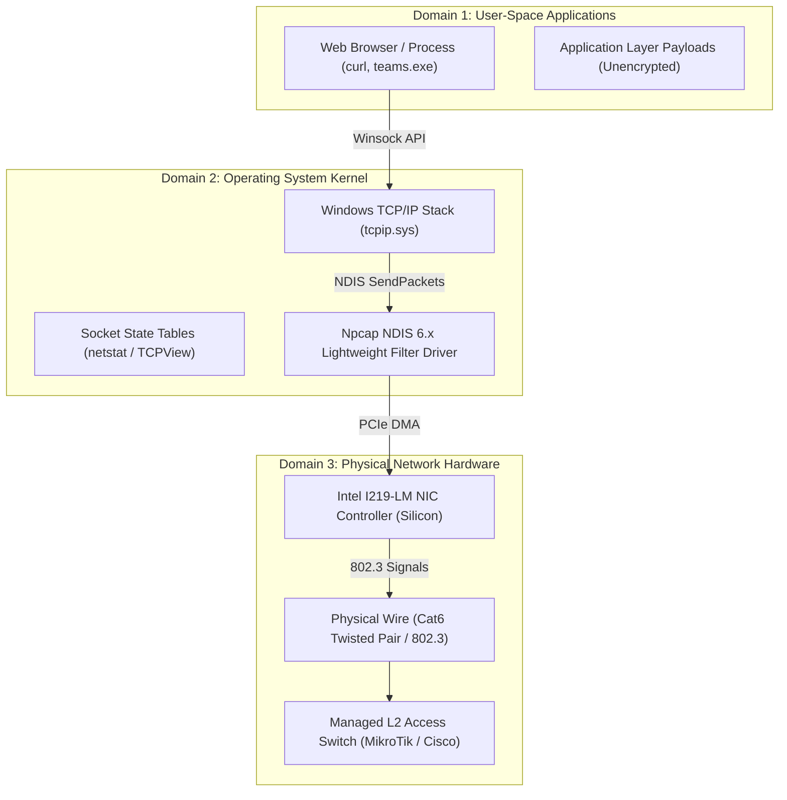
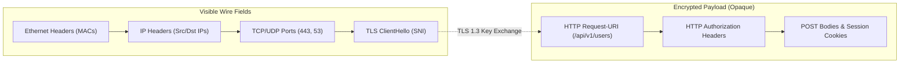

# PACKET VISIBILITY LIMITATIONS & NETWORK CAPTURE BOUNDARIES REPORT

**PRODUCT:** Eldar Jamiyev’s Infrastructure Intelligence (EJII / EJI)  
**SCOPE:** Physical Wire Realities, NIC Silicon Offloading, Switched Ethernet Fabrics & Encrypted Protocol Boundaries  
**DATE OF AUDIT:** October 15, 2026  
**CLASSIFICATION:** Systems Engineering & Senior Network Protocol Forensics  

---

## 1. EXECUTIVE OVERVIEW

In network protocol engineering and infrastructure forensics, understanding **what a capture engine can and cannot physically observe** is paramount. A common point of confusion among junior administrators is why certain network interactions appear in one format locally while behaving differently across the corporate network.

This document outlines the strict physical, cryptographic, and hardware-level visibility boundaries governed by the laws of physics, IEEE 802.3 Ethernet standards, and modern operating system kernels.

---

## 2. THE THREE DOMAINS OF NETWORK OBSERVABILITY

---

## 3. HARDWARE OFFLOADING ARTIFACTS (NIC SILICON VS DRIVER)

Modern enterprise network interface cards (such as the **Intel Ethernet Connection I219-LM** on our production host) perform high-speed packet processing directly on silicon to reduce CPU overhead. This introduces specific observable artifacts in packet captures:

### 3.1 Large Send Offload (LSO / TSO)
- **The Reality:** Standard Ethernet Maximum Transmission Unit (MTU) is 1,500 bytes (1,514 bytes with Ethernet header).
- **The Artifact:** In user-space captures, outbound TCP packets can appear with lengths of **16,000 to 64,000 bytes**!
- **Explanation:** The Windows kernel hands a large buffer to the driver. Npcap hooks into the NDIS stack *before* the hardware NIC silicon segments the payload into 1,514-byte frames. The packets leaving the physical wire are standard MTU-compliant frames; only the pre-offload capture exhibits jumbo buffers.

### 3.2 Transmit Checksum Offload (Tx Checksum Offloading)
- **The Reality:** Every IPv4 header and TCP/UDP segment contains a 16-bit one's complement checksum.
- **The Artifact:** In packet captures, outbound frames often show `Checksum: 0x0000` or `[Checksum Incorrect]`.
- **Explanation:** To maximize throughput, the CPU leaves the checksum field blank (`0x0000`). The Intel NIC hardware computes and writes the valid checksum in real time as the bits are serialized onto the wire. Incoming packets have already traversed the wire and will always display authentic valid checksums.

### 3.3 Large Receive Offload (LRO / GRO)
- On high-throughput inbound streams, the NIC or NDIS driver coalesces multiple consecutive TCP segments into a single composite packet before delivering it to the network stack, reducing context switching.

---

## 4. SWITCHED FABRIC & TOPOLOGICAL VISIBILITY BOUNDARIES

### 4.1 Switched Ethernet vs Hubs
- **Switched Architecture:** Modern Ethernet access switches (e.g. Cisco Catalyst, MikroTik RouterOS) maintain an internal Content-Addressable Memory (CAM) table mapping MAC addresses to specific switch ports.
- **Visibility Boundary:** A host interface (even in promiscuous mode) only receives:
  1. Frames destined to its own physical MAC address (`Unicast`).
  2. Frames destined to the broadcast MAC (`FF:FF:FF:FF:FF:FF`, e.g. ARP Requests, DHCP Discover).
  3. Frames destined to registered multicast groups (`01:00:5E:xx:xx:xx` / `33:33:xx:xx:xx:xx`, e.g. mDNS, LLMNR, OSPF).
- **Network-Wide Traffic:** To capture traffic between third-party hosts `Host A` and `Host B`, the switch must be configured with a **Switched Port Analyzer (SPAN / Port Mirror)** or an in-line physical Ethernet TAP must be installed.

---

## 5. CRYPTOGRAPHIC VISIBILITY BOUNDARIES (ENCRYPTION REALITIES)

EJII strictly abides by cryptographic integrity: **no platform can decrypt modern symmetric ciphers without possessing the private key or session keylog.**

### 5.1 TLS 1.2 vs TLS 1.3 Visibility
- **TLS 1.2:** Negotiates cipher suites in plaintext. Server certificates are transmitted in plaintext (allowing subject and issuer extraction on the wire).
- **TLS 1.3:** Entire handshake following the `ClientHello` and `ServerHello` is encrypted. The server certificate is transmitted inside an encrypted wrapper; only the client's `server_name` (SNI) in the `ClientHello` is visible in plaintext.

### 5.2 Encrypted Client Hello (ECH) & DNS-over-HTTPS (DoH)
- When **Encrypted Client Hello (ECH)** (RFC 8744) is negotiated, the SNI extension itself is encrypted using a public key published in the target domain's DNS `HTTPS` record.
- In ECH scenarios, EJI's URL Intelligence Engine correctly identifies the traffic evidence as `UNAVAILABLE` or `CORRELATED` via local socket attribution, refusing to guess or invent the encrypted hostname.

### 5.3 QUIC / HTTP/3 Encryption
- QUIC runs over UDP port 443. Unlike TCP, QUIC encrypts both the transport parameters and packet sequence numbers.
- EJII captures and displays the visible UDP datagram, the Initial Packet Long Header, and Connection IDs (DCID/SCID), but explicitly labels protected application data as opaque.

---

## 6. WINDOWS NT SOCKETS VS PHYSICAL WIRE PACKETS

| Dimension | Windows Socket Inspection (`netstat` / `TCPView`) | Physical Npcap Wire Sniffer |
| :--- | :--- | :--- |
| **Observation Point** | Winsock API / Transport Layer abstraction in kernel (`tcpip.sys`) | Data Link Layer (Layer 2) at the NDIS miniport driver |
| **ICMP Echo / Replies** | **Invisible** (ICMP has no port numbers or persistent socket descriptors) | **100% Visible** (captured directly as IP protocol 1) |
| **TCP SYN Handshakes** | **Invisible** (socket only appears in table once `ESTABLISHED` or `SYN_SENT`) | **100% Visible** (SYN, SYN-ACK, ACK frames captured with sequence numbers) |
| **Malformed / Dropped Frames** | **Invisible** (silently discarded by kernel TCP/IP stack) | **100% Visible** (captured before stack validation) |
| **Process Attribution** | **100% Native** (kernel directly links socket to PID) | Requires correlation with OS socket table |

---

## 7. SUMMARY

Eldar Jamiyev’s Infrastructure Intelligence operates with complete scientific clarity regarding these visibility boundaries. By combining **native Npcap kernel-level packet capture** with **real-time OS socket correlation**, EJII achieves the highest fidelity possible on physical workstation and server hardware without ever resorting to simulated fiction.
