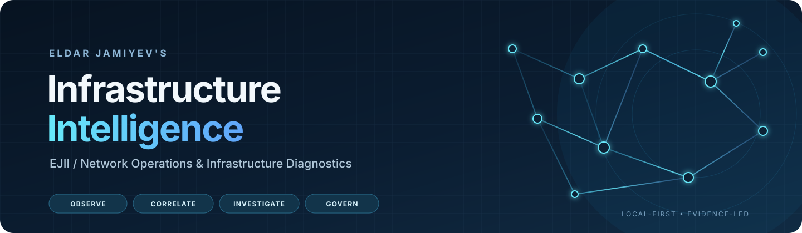
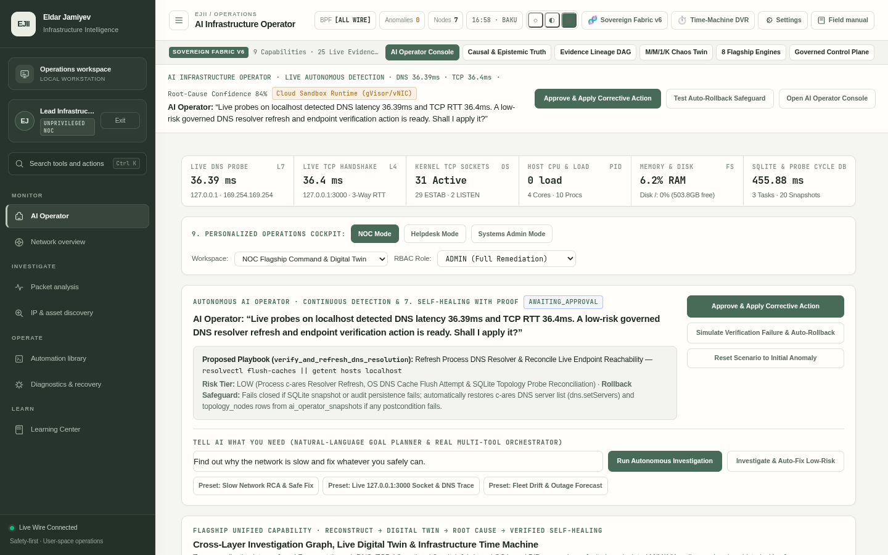
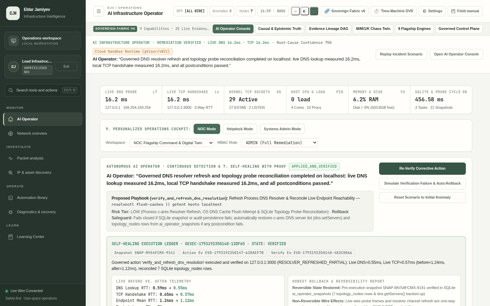
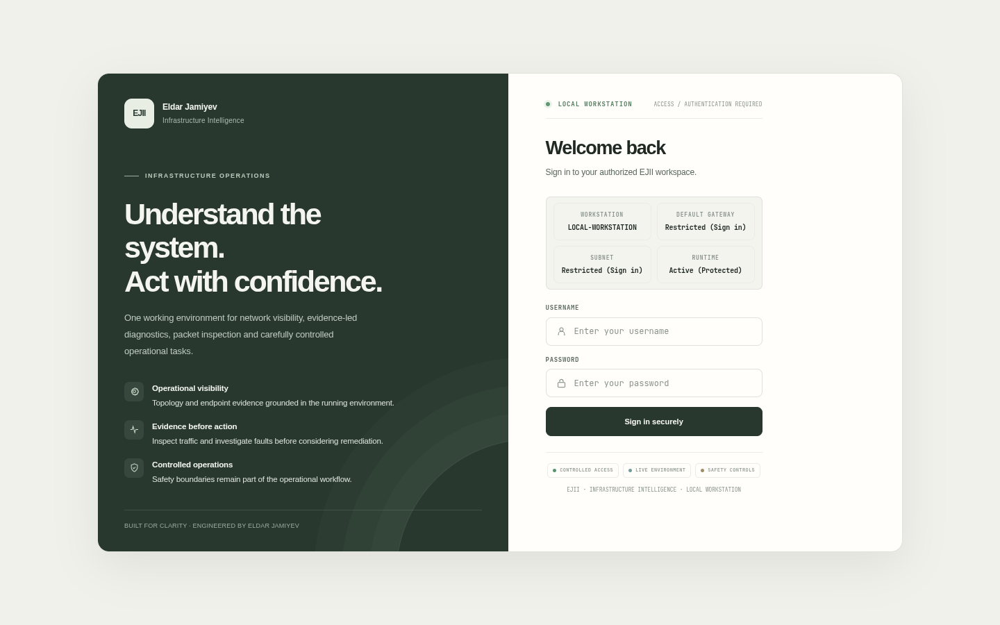

<!-- EJII README: source-aligned documentation; metrics below are repository snapshots, not live service SLAs. -->

<strong>A local-first workspace for infrastructure visibility, network diagnostics, packet analysis, and governed operations.</strong>

  
  
  
  
  
  
  

  <a href="#overview">Overview</a> ·
  <a href="#screenshots">Screenshots</a> ·
  <a href="#capabilities">Capabilities</a> ·
  <a href="#architecture">Architecture</a> ·
  <a href="#quick-start">Quick start</a> ·
  <a href="#security-and-deployment-notes">Security</a> ·
  <a href="#documentation">Documentation</a>

> **Project status:** EJII is an actively evolving, self-hosted engineering project. This README describes the code currently present in the repository; it is not a claim of independent enterprise certification, a production SLA, or a guarantee that every optional collector works on every operating system. Review the deployment and platform limitations before connecting it to a real environment.

## Overview

**EJII — Eldar Jamiyev's Infrastructure Intelligence** is a Node.js application that brings together a browser-based operations workspace, network and host diagnostics, packet inspection, evidence-led incident investigation, and controlled automation.

The project is designed around a practical operational sequence:

**Observe → Correlate → Investigate → Explain → Authorize → Execute → Verify**

It is not a ticketing system, a hosted monitoring service, or a replacement for dedicated network-management platforms. Its focus is to give an operator a single local workspace for examining infrastructure signals, understanding what the available evidence supports, and reviewing operational actions before execution.

### Repository snapshot

The figures below were checked against the default branch on **30 October 2026**. They describe source files and configuration, not live runtime performance.

| Item | Repository-backed value |
|---|---:|
| Package version | <code>6.0.0-sovereign-intelligence-fabric</code> |
| Master test runner | 100 named suite entries |
| Capability registry | 17 registered capability identifiers |
| Main workspace navigation | 7 operational areas |
| Runtime npm dependencies | 3: Express, net-snmp, ws |
| Persistence | Node.js built-in SQLite API |

**Important:** “100 registered suites” means the current master runner contains 100 suite entries. It does **not** mean that all 100 suites were executed successfully in this review. Run the test command in your own environment to obtain a current result.

## Screenshots

The following screenshots are image files committed in this repository.

  
  

  

*Screenshots illustrate the interface. They should not be interpreted as proof of live connectivity, a particular test result, or the state of a deployed environment.*

## Capabilities

The current frontend exposes seven main workspace areas:

| Workspace area | Purpose |
|---|---|
| **AI Operator** | Conversational operator interface for asking questions, reviewing context, and initiating supported workflows. |
| **Network overview** | Network topology, connected resources, endpoint context, and infrastructure status. |
| **Packet analysis** | Packet stream inspection, protocol decoding, filters, and packet-level investigation. |
| **IP & asset discovery** | Address and service discovery, host inspection, and equipment inventory workflows. |
| **Automation library** | Access to local diagnostic and maintenance scripts through the automation subsystem. |
| **Diagnostics & recovery** | Host, network, service, and root-cause diagnostics, with controlled remediation workflows. |
| **Learning Center** | Guided networking and system-administration material and interactive learning exercises. |

### Core engineering areas

- **Network and host diagnostics:** ICMP, TCP port checks, DNS resolution, HTTP and TLS checks, host metrics, service verification, and SNMP-related functionality.
- **Topology and inventory:** discovery and reconciliation logic, topology nodes and relationships, equipment records, and historical topology snapshots.
- **Packet analysis:** packet decoding, stream reassembly, BPF filter compilation, PCAP/PCAPNG handling, and an optional native packet-capture path.
- **Incident reasoning:** evidence collection, cross-layer correlation, causal investigation, ranked hypotheses, counter-evidence, and explicit uncertainty.
- **Knowledge retrieval:** local retrieval over project runbooks and policy documents to support investigation and operator explanations.
- **Action governance:** capability checks, role-based access, action previews, approval gates, execution records, and post-action verification paths.
- **Observability:** HTTP health endpoint, Prometheus-format metrics endpoint, WebSocket updates, incident recording, and telemetry history tools.
- **Scenario analysis:** isolated digital-twin branches for examining hypothetical network or capacity changes. Simulation output is distinct from observed telemetry.

The code also includes analysis engines for spectral anomaly detection, CUSUM change-point detection, Holt-Winters forecasting, routing analysis, QoS inspection, and TLS certificate posture checks. Availability and data quality depend on the relevant source telemetry and runtime environment.

## Architecture

EJII is a single Node.js server with a static browser client and a set of backend subsystems. The following diagram is a conceptual map of the modules present in the repository.

~~~mermaid
flowchart TB
    subgraph Clients["Operator interfaces"]
        UI["Browser workspace HTML · CSS · JavaScript"]
        Mobile["Mobile companion UI"]
        CLI["Diagnostics CLI"]
        Desktop["Desktop launcher"]
    end

    subgraph Runtime["Node.js application"]
        HTTP["Express REST API"]
        WS["WebSocket service"]
        Auth["Authentication · RBAC"]
        Ops["Operations and capability control"]
    end

    subgraph Engines["Infrastructure and intelligence modules"]
        Net["Network diagnostics DNS · ICMP · TCP · TLS · HTTP · SNMP"]
        Capture["Packet capture and decoding Npcap / supported fallback · BPF · PCAP"]
        Topology["Topology and equipment inventory"]
        Reasoning["Evidence · RCA · reasoning · local RAG"]
        Govern["Policy checks and governed actions"]
        Observe["Metrics · event stream · incident history"]
        Learn["Learning content and labs"]
    end

    subgraph Storage["Local persistence"]
        DB[("SQLite database")]
        Audit[("Audit and security records")]
        Files[("Runbooks · policies · configuration")]
    end

    UI --> HTTP
    UI <--> WS
    Mobile --> HTTP
    CLI --> Net
    Desktop --> UI
    HTTP --> Auth
    Auth --> Ops
    Ops --> Net
    Ops --> Capture
    Ops --> Topology
    Ops --> Reasoning
    Ops --> Govern
    Ops --> Observe
    Ops --> Learn
    Net --> DB
    Capture --> DB
    Topology --> DB
    Reasoning --> DB
    Reasoning --> Files
    Govern --> Audit
    Observe --> DB
~~~

### Evidence lifecycle

EJII's v6 capability documentation defines separate evidence classes so that a calculation, hypothesis, missing signal, or simulation is not silently presented as a direct observation.

~~~mermaid
flowchart LR
    Collect["Host and network collectors"] --> Evidence["Evidence records"]
    Evidence --> Correlate["Cross-layer correlation"]
    Correlate --> Hypotheses["Hypotheses and counter-evidence"]
    Hypotheses --> Review["Operator review"]
    Review -->|Approved action| Preview["Action preview and policy checks"]
    Preview --> Execute["Authorized execution"]
    Execute --> Verify["Post-action verification"]
    Verify --> Audit["Audit record and updated context"]
    Hypotheses -->|What-if branch| Sim["Isolated simulation"]
    Sim -.->|Marked simulated; not live proof| Review
~~~

### Evidence categories

| Evidence class | Meaning |
|---|---|
| <code>observation</code> | A value or event collected from a source. |
| <code>calculation</code> | A computed result derived from input data. |
| <code>hypothesis</code> | A proposed explanation that still requires evaluation. |
| <code>confirmed_finding</code> | A conclusion supported by the engine's defined evidence rules. |
| <code>counter_evidence</code> | Data that conflicts with a hypothesis. |
| <code>missing_evidence</code> / <code>stale_evidence</code> | A signal that could not be collected or is no longer sufficiently fresh. |
| <code>simulated_result</code> | Output from an isolated scenario, not an observation of the live network. |
| <code>action_result</code> / <code>verification_result</code> | The result of an authorized operation and its follow-up check. |

This separation matters: a failed probe is not automatically proof of a firewall block, an unavailable collector is not a zero-valued metric, and a simulated branch is not evidence that a live change has occurred.

## AI and investigation model

The AI-related components combine deterministic application logic with an optional language-model integration.

- **Deterministic baseline:** the briefing provider defaults to a deterministic mode when no external model is configured.
- **Optional model endpoint:** the provider can call a configured local or remote endpoint. The exact provider, endpoint, model, credentials, and response format must be configured by the operator.
- **Local knowledge retrieval:** the RAG subsystem uses project knowledge such as <code>runbooks/</code> and <code>policies/</code>.
- **Evidence-aware reasoning:** observed facts, failed collectors, contradictory evidence, and missing information are represented separately in the investigation context.
- **Operator control:** an AI-generated explanation is an aid to investigation, not authorization to make a production change.

Do not assume the system is using a local LLM simply because the application is running locally. Unless a model endpoint is configured, the deterministic provider is used. When a remote LLM is configured, review what diagnostic context may be sent to that service before enabling it with sensitive infrastructure data.

## Packet capture and visibility boundaries

The repository contains a Python capture component that attempts to load the Npcap/WinPcap-compatible capture library on Windows and libpcap-compatible libraries on other systems. The application also contains socket-based diagnostics and fallback handling.

These collection modes are not equivalent:

- **Native packet capture** can inspect frames visible to the selected capture interface when the relevant library, driver, permissions, and interface are available.
- **Socket diagnostics** can test connectivity and inspect operating-system socket information; they do not provide a copy of every frame on the physical network.
- **Switched networks** normally deliver only traffic visible to the local interface. A workstation capture is not automatically a network-wide mirror.
- **Encryption and offload** limit what can be inferred from packet data. TLS-encrypted application payloads are not readable merely because packets were captured.
- **Fallback telemetry** must be interpreted according to its source. It should not be described as physical packet capture.

For a more detailed explanation, see [Packet Visibility Limitations](docs/audits/PACKET_VISIBILITY_LIMITATIONS.md) and [Protocol Dissector Coverage](docs/audits/PROTOCOL_DISSECTOR_COVERAGE.md).

## API surface

The Express server mounts the following API groups:

| Route | Purpose |
|---|---|
| <code>/api/health</code> | Basic server health and runtime metadata. |
| <code>/api/auth</code> | Authentication routes. |
| <code>/api/diagnostics</code> | Host diagnostics and remediation-related routes. |
| <code>/api/network</code> | Network diagnostics, discovery, topology, and packet workflows. |
| <code>/api/tools</code> | Diagnostic tool endpoints. |
| <code>/api/rca</code> | Root-cause and reasoning endpoints. |
| <code>/api/observability</code> | Observability and telemetry endpoints. |
| <code>/api/learning</code> | Learning Center endpoints. |
| <code>/api/v6</code> | v6 capability, evidence, temporal graph, investigation, simulation, and governed-action endpoints. |
| <code>/metrics</code> | Prometheus text exposition endpoint. |

Protected routes require authentication and apply the configured authorization checks. Consult the route handlers and middleware before integrating an external client.

## Quick start

### Runtime requirement

**Use Node.js 22.13.0 or newer.** The database layer imports Node's built-in <code>node:sqlite</code> module. That module was introduced in Node 22.5.0 and no longer required the experimental CLI flag from Node 22.13.0. The Windows launcher still prints an older Node 18+ message; that check is stale and should not be treated as the application's actual runtime requirement.

References: [Node.js SQLite API](https://nodejs.org/api/sqlite.html) · [Node.js 22.5.0 release notes](https://github.com/nodejs/nodejs.org/blob/main/apps/site/pages/en/blog/release/v22.5.0.md)

### Manual start

~~~bash
git clone https://github.com/EldarJamiyev/Eldar-Jamiyev-Infrastructure-Intelligence.git
cd Eldar-Jamiyev-Infrastructure-Intelligence

npm install
npm start
~~~

By default, the server listens on <code>http://127.0.0.1:8443</code>. The default host is loopback-only, which is appropriate for local workstation use.

Check that the server is responding:

~~~bash
curl http://127.0.0.1:8443/api/health
~~~

The first database initialization creates the workstation's initial user accounts. Review the startup output and the generated first-run credential file under <code>data/security/</code>; protect that file and change initial credentials before using the application beyond a local evaluation.

### Platform launchers

The repository includes launch scripts:

**Windows**
~~~bat
setup-launcher.bat
~~~

**Linux / POSIX shell**
~~~bash
chmod +x setup-launcher.sh
./setup-launcher.sh
~~~

The launchers install npm dependencies when needed, run a pre-flight test sequence in a temporary data directory, and stop if the test runner exits unsuccessfully. The Windows launcher also attempts to free port 8443 by terminating a process already listening on that port. Check the port owner before using that launcher on a workstation with other services.

### Useful npm commands

| Command | What it does |
|---|---|
| <code>npm start</code> | Starts the server using the configured host and port. |
| <code>npm run dev</code> | Starts the development server on port 3000 and binds to <code>0.0.0.0</code>; use only on a trusted network. |
| <code>npm run build</code> | Compiles the TypeScript sources using the repository's TypeScript configuration. |
| <code>npm test</code> | Runs the TypeScript pre-test build and then the master test runner. |
| <code>npm run desktop</code> | Starts the desktop launcher; an Electron runtime is not included in the declared dependencies, so the browser fallback may be used. |
| <code>npm run cli</code> | Invokes the diagnostics CLI. |

## Diagnostics CLI

The CLI supports targeted operations; it is not a replacement for the full browser workspace.

~~~bash
# ICMP reachability
node bin/run-diagnostics-cli.js ping example.com

# TCP port check
node bin/run-diagnostics-cli.js port example.com 443

# Common-port sweep — only scan systems you are authorized to test
node bin/run-diagnostics-cli.js sweep 192.0.2.10

# DNS, TLS, and HTTP checks
node bin/run-diagnostics-cli.js dns example.com
node bin/run-diagnostics-cli.js tls example.com
node bin/run-diagnostics-cli.js http https://example.com

# Host diagnostics and audit-chain verification
node bin/run-diagnostics-cli.js host
node bin/run-diagnostics-cli.js audit-verify

# JSON output
node bin/run-diagnostics-cli.js --json
~~~

Use only against systems and networks for which you have explicit authorization.

## Configuration

The application reads environment variables through <code>src/config.js</code>. The example file is <code>.env.example</code>; values are intentionally left blank.

| Variable | Purpose | Default / requirement |
|---|---|---|
| <code>EJII_HOST</code> | Listen address. | Defaults to <code>127.0.0.1</code>. |
| <code>EJII_PORT</code> | Listen port. | Defaults to <code>8443</code>. |
| <code>EJII_DATA_DIR</code> | Runtime data directory. | Defaults to the repository's <code>data/</code> directory. |
| <code>EJII_ADMIN_PASSWORD</code> | Optional initial production admin password. | In production, at least 12 characters and not a known default. |
| <code>EJII_HMAC_SECRET</code> | HMAC audit-chain secret. | Required outside local-only development / in production; at least 32 characters. |
| <code>EJII_JWT_SECRET</code> | JWT signing secret. | Required outside local-only development / in production; at least 32 characters and different from the HMAC secret. |
| <code>EJII_EVALUATION_MODE</code> | Enables local evaluation behavior. | Not permitted when bound to a non-loopback interface or in production. |

For non-local or production deployment, generate separate cryptographically random HMAC and JWT secrets, keep them out of source control, and configure a strong administrator password. The application intentionally rejects missing, weak, reused, or known placeholder secrets in production mode.

## Security and deployment notes

Read this section before exposing EJII to another device or network.

1. **Keep the default loopback binding unless remote access is required.** Changing <code>EJII_HOST</code> to <code>0.0.0.0</code> exposes the listener on network interfaces. Put an appropriate access-control boundary in front of it and restrict inbound access.
2. **Use separate secrets.** Production mode requires explicit, unique HMAC and JWT secrets of at least 32 characters. Do not copy example secrets into a live deployment.
3. **Protect initial credentials and runtime data.** Secure the generated first-run credential file, SQLite database, audit records, and packet captures. These files may contain sensitive infrastructure information.
4. **Use least privilege.** Some collection and remediation functions depend on operating-system permissions, drivers, and elevated capabilities. Do not run the entire application as Administrator or root by default.
5. **Review every action.** Diagnostic probes, packet capture, and remediation can affect real systems. Use only approved targets and review action scope before execution.
6. **Review external AI settings.** A remote model endpoint may receive diagnostic context. Do not send confidential infrastructure data to an endpoint that has not been approved.

### Docker status — configuration requires correction

A Dockerfile and Compose file are present, but the current Compose file should **not** be treated as a ready-to-run production deployment.

The checked-in <code>docker-compose.yml</code> sets <code>NODE_ENV=production</code> while also supplying hard-coded placeholder values for <code>EJII_HMAC_SECRET</code> and <code>EJII_JWT_SECRET</code>. Those exact values are listed as insecure in <code>src/config.js</code>, so the production configuration validator rejects them. The Compose file also binds the service to <code>0.0.0.0</code> and grants <code>NET_RAW</code> and <code>NET_ADMIN</code> capabilities.

Before using Compose:

- Replace the hard-coded secret values with separately generated secrets that satisfy the validator.
- Restrict the published port to the intended interface and network.
- Remove container capabilities that are not required for the selected collectors.
- Validate the image, persistent volume permissions, and capture requirements in a non-production environment first.

The Dockerfile currently uses a Node 22 base image. Confirm that the resolved image version satisfies the Node.js 22.13.0+ requirement above.

## Testing and verification

The current <code>tests/run-all-tests.js</code> file declares **100 named suite entries**. The suite coverage spans network probes, topology, packet decoding, stream handling, security and RBAC, AI reasoning, remediation safeguards, observability, API contracts, and frontend wiring.

Run:

~~~bash
npm test
~~~

The <code>pretest</code> script runs the TypeScript compiler before the master test runner. Some suites are integration-oriented and depend on operating-system behavior, network reachability, capture support, or other environmental conditions. Run them in a controlled environment and inspect the actual output and exit code.

The repository contains audit and verification reports from earlier development snapshots. Their dates and test-suite counts differ because the code has continued to change. Treat those documents as historical records of the stated audit baseline, not as proof that the current branch has passed the same checks. The current runner source and a fresh local test execution are the appropriate references for the current test inventory and result.

## Platform and operational limitations

- **Packet visibility is interface-bound.** Capturing on a workstation does not provide visibility into all traffic crossing a switched network.
- **Npcap/libpcap support is environment-dependent.** Driver/library presence, permissions, interface selection, and operating-system behavior affect capture availability.
- **The database uses Node's built-in SQLite module.** Node versions older than 22.5 do not provide this module; use Node 22.13.0 or later to avoid requiring the earlier experimental flag.
- **Platform parity is not universal.** Some Windows host and packet-capture functions have OS-specific dependencies. The presence of a POSIX launcher does not mean every Windows collector is available on Linux or macOS.
- **Simulations are simulations.** Digital-twin and what-if outputs must remain clearly separated from measurements collected from live infrastructure.
- **A local PWA cache is not a fully offline backend.** The service worker caches selected client assets, while API operations still depend on a reachable server.
- **This is not an externally certified product.** Validate security, data handling, reliability, and operational impact before using it in a production environment.

## Repository layout

~~~text
.
├── bin/                 # Desktop and CLI launchers
├── desktop/             # Desktop window integration
├── docs/                # Capability maps and technical audits
│   ├── assets/          # README artwork
│   └── audits/          # Verification and limitation reports
├── mobile/              # Separate mobile companion client
├── policies/            # Security and operational policy documents
├── public/              # Main browser UI, styles, scripts, and PWA assets
├── runbooks/            # Local operational knowledge and procedures
├── scripts/             # Windows batch and PowerShell utilities
├── src/
│   ├── ai/              # Forecasting and analysis engines
│   ├── api/             # Express routes and middleware
│   ├── core/            # AI, evidence, reasoning, security, and governance
│   ├── db/              # SQLite schema and repositories
│   ├── diagnostics/     # Host and process/socket diagnostics
│   ├── network/         # Discovery, capture, decoding, and topology
│   ├── observability/   # Incident recording and telemetry history
│   ├── protocols/       # DNS, ICMP, TCP, TLS, and HTTP probes
│   ├── security/        # TLS posture and policy tools
│   └── server.js        # Main application entry point
├── tests/               # Unit, integration, and verification suites
├── Dockerfile
├── docker-compose.yml
├── package.json
└── README.md
~~~

## Documentation

| Document | Focus |
|---|---|
| [v6 Capability Map](docs/EJII_V6_CAPABILITY_MAP.md) | Capability registry, evidence types, temporal graph, correlation, simulation, and action governance. |
| [Packet Visibility Limitations](docs/audits/PACKET_VISIBILITY_LIMITATIONS.md) | Capture boundaries, switched networks, encryption, and NIC offload behavior. |
| [Protocol Dissector Coverage](docs/audits/PROTOCOL_DISSECTOR_COVERAGE.md) | Protocol parsing and dissector coverage notes. |
| [AI Brain and Wire Probe Truth Audit](docs/audits/EJII_AI_BRAIN_AND_WIRE_PROBE_TRUTH_AUDIT.md) | Evidence handling, probe semantics, and reasoning constraints. |
| [Release Integrity Report](docs/audits/EJII_RELEASE_INTEGRITY_REPORT.md) | Historical release and security review; read with its stated audit baseline. |
| [Test Execution Integrity Report](EJII_TEST_EXECUTION_INTEGRITY_REPORT.md) | Historical test-runner audit; its reported suite count predates the current 100-entry runner. |
| [Secure Deployment Report](EJII_SECURE_DEPLOYMENT_REPORT.md) | Historical deployment and security notes; verify all instructions against the current configuration. |

## License and ownership

The package metadata currently declares <code>UNLICENSED</code>, and the repository does not provide an open-source license granting reuse rights. All rights remain with the author unless separate written permission or a license is provided.

**Author:** Eldar Jamiyev  
**Repository:** [Eldar-Jamiyev-Infrastructure-Intelligence](https://github.com/EldarJamiyev/Eldar-Jamiyev-Infrastructure-Intelligence)

---

  Built as an evolving infrastructure engineering project. Evidence first. Explicit limits. Human control over consequential actions.

