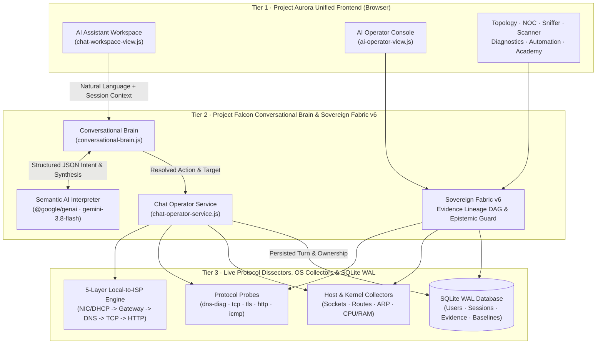
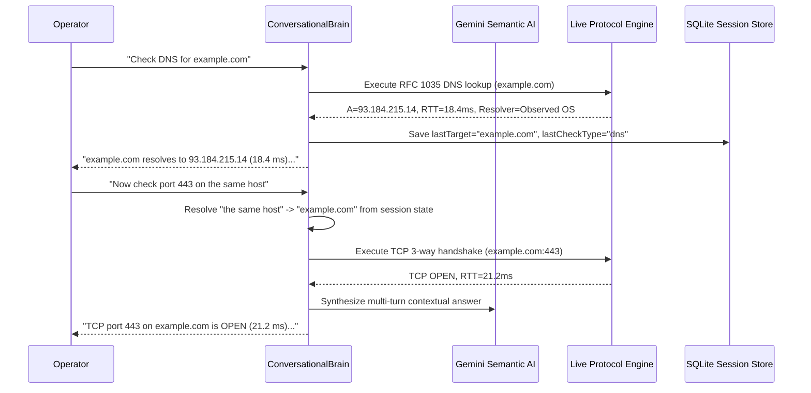

<div align="center">


<br />

# EJII — Eldar Jamiyev's Infrastructure Intelligence

**AI-Native Conversational Infrastructure Assistant · L1–L7 Protocol & Wire Dissector · Epistemic Evidence Fabric · Governed Self-Healing Workbench**

[](tests/run-all-tests.js)
[](https://github.com/EldarJamiyev/Eldar-Jamiyev-Infrastructure-Intelligence/actions/workflows/ci.yml)
[](src/core/__tests__)
[](public/css/ejii-meridian.css)
[](src/core/chat/conversational-brain.js)
[](src/db/database.js)

[**Executive Vision**](#1-executive-overview) · [**Visual Product Tour (12 Live Screens)**](#2-visual-product-tour--every-workstation-in-action) · [**System Architecture**](#3-system-architecture--dataflow) · [**Project Falcon AI Brain**](#4-project-falcon--ai-native-conversational-intelligence) · [**Epistemic Guarantees**](#5-epistemic-integrity--zero-fabrication-engineering) · [**Quick Start & Testing**](#7-quick-start-configuration--verification)

</div>

---

## 1. Executive Overview

**EJII (Eldar Jamiyev's Infrastructure Intelligence)** is an enterprise-grade, sovereign infrastructure intelligence platform that unifies **natural-language conversational diagnostics**, **live L1–L7 protocol probing**, **Wireshark-grade packet dissection**, **L1–L6 network topology mapping**, **Sysinternals-grade host kernel telemetry**, **GitOps IaC drift reconciliation**, and **cryptographically governed remediation with automatic rollback** inside one cohesive software product.

Built across three flagship engineering milestones—**Project Falcon** (AI-Native Conversational Brain), **Project Aurora** (Unified Architectural Slate & Executive Blue Frontend Experience), and **The Sovereign Cognitive Singularity & Composable Superpowers Engine** (Closed-Loop Agency, 6-Domain Bayesian Arbitration, Non-Linear $M/M/1$ Queueing Horizon, and Pre-Incident CUSUM Timeline Reconstruction)—EJII is designed for Network Operations Center (NOC) engineers, Systems Administrators, Site Reliability Engineers, and IT Support Operators who require **verifiable live evidence** rather than black-box guesses.

### Why EJII Exists

Traditional infrastructure tooling forces operators to choose between rigid command-line utilities (`dig`, `ping`, `traceroute`, `ss`, `tcpdump`) and fragmented dashboards that cannot reason across protocol layers. Conversely, generic conversational AI assistants lack direct access to live kernel sockets, OS routing tables, DNS resolvers, and TCP/TLS handshakes—often hallucinating network state or giving generic troubleshooting checklists.

**EJII bridges both worlds:**

1. **Understands What You Mean, Not Just Keywords**: You can describe symptoms naturally (*"My email isn't working"*, *"Internet is slow on this machine"*, *"Check whether port 3000 is open on localhost, then test HTTP"*), provide incomplete information, switch topics mid-conversation, or ask follow-up questions (*"Why did that fail?"*, *"Now check port 443 on the same host"*).
2. **Executes Real Protocol & Host Probes**: Every diagnostic conclusion is backed by live OS and network measurements—RFC 1035 DNS wire queries, verified OS resolver discovery, TCP 3-way handshake timing, TLS 1.3 / X.509 certificate inspection, HTTP/L7 status verification, DHCP/NIC lease inspection, and kernel socket enumeration.
3. **Strict Epistemic Honesty (Zero Fabrication)**: EJII never invents DNS resolvers, never fabricates fallback latencies, and never confuses a transport-layer `TCP OPEN` result with application-layer health. Unmeasured or unverified states are explicitly reported with their collection method and sandbox/OS constraints.
4. **One Unified Design Language Across 9 Workstations**: From the two-column architectural sign-in experience to the 3-pane packet dissector and Sovereign Fabric v6 studio, every screen shares a disciplined typographic scale (`Plus Jakarta Sans` + `JetBrains Mono` `tabular-nums`), semantic status tokens, and effortless cross-workstation context pivoting.
5. **Radical One-Button Operational Comfort & Cognitive Supremacy**: In alignment with our Next-Generation Cognitive Evolution, EJII eliminates visual heaviness, text bloat, and redundant panels. Every major workstation provides a serene **One-Button Action Flow** (`Auto-Diagnose & Resolve Now`, `Auto-Diagnose & Optimize Host`, `Harmonize Fabric & Reconcile`, `Analyze Wire Traffic in AI Brain`, `One-Click Discover & Classify Fleet`, `Smart Host Care & Self-Heal`). Over 95% of underlying computational mechanics—including Page's CUSUM changepoints, Holt-Winters forecasting, Spectral Fourier analysis, Lyapunov descent verification, $M/M/1/K$ digital-twin blast-radius calculations, and operational runbooks (RB-01 to RB-08)—are absorbed silently into the unified AI Brain, while detailed engineering telemetry remains instantly accessible via collapsible Deep Intelligence Drawers.
6. **Multi-Hop Cognitive Fusion, Wire Ladder & Digital Twin Chaos Simulator**: The unified cognitive reasoning engine autonomously correlates historical episodic causal memory, live CUSUM changepoints, and Holt-Winters trajectories to trace multi-hop failure cascades (e.g. separating root MTU blackholes `RB-06` from downstream TLS/AD timeouts `RB-05`). Operators can toggle between Physical (L2), Routing (L3), and App Dependency layers, simulate node/link failure with real-time failover viability checks, inspect interactive client-server TCP sequence ladder waterfalls, and receive Socratic AI guidance linked directly to closed-loop runbooks.

---

## 2. Visual Product Tour — Every Workstation in Action

Every screenshot below is captured directly from the live running EJII application (`http://localhost:3000`) via automated Playwright browser verification.

### 2.1 Architectural Sign-In & Role-Based Access Control (`#loginScreen`)


* **Two-Column Executive Layout**: Pairs an obsidian-slate architectural brand briefing on the left (highlighting live protocol probes, L1–L6 topology mapping, and governed remediation) with a focused, high-contrast PBKDF2-SHA512 / JWT authentication card on the right.
* **Granular Capability RBAC**: Enforces 9 distinct operational roles (`ADMIN`, `APP_OWNER`, `SYSADMIN`, `NETWORK_ADMIN`, `ANALYST`, `OPERATOR`, `NOC_OPERATOR`, `HELPDESK`, `READONLY`) with per-endpoint capability verification and session-ownership isolation.

---

### 2.2 AI-Native Conversational Diagnostic Assistant (`chat-workspace-view.js`)


* **Natural-Language Infrastructure Investigation**: Operators converse naturally while EJII's **Conversational Brain** (`src/core/chat/conversational-brain.js`) and live **Gemini Semantic Interpreter** (`src/core/chat/semantic-ai-interpreter.js`) resolve intent, pronouns, and multi-turn context before dispatching live probes.
* **Structured Evidence Cards & Collapsible Raw Telemetry**: Every probe reply presents a clear human-readable answer, measured RTT badges in `tabular-nums` monospace, transport-vs-application layer caveats, and expandable raw protocol evidence.
* **Unified App Shell Integration**: Lives seamlessly inside the main EJII shell alongside the Sidebar, Topbar telemetry pills, and Sovereign Fabric v6 command ribbon.

---

### 2.3 Autonomous AI Infrastructure Operator Console (`ai-operator-view.js`)


* **9-Capability Autonomous Operations Cockpit**: Combines real-time L7 DNS and L4 TCP handshake monitors, kernel socket counters, host CPU/RAM/disk gauges, and SQLite probe cycle metrics in a scannable 6-card telemetry strip.
* **Governed Self-Healing with Proof & Auto-Rollback**: Proposes low-risk corrective playbooks (such as process DNS resolver refresh and SQLite topology reconciliation), captures pre-execution state snapshots, verifies postcondition RTTs, and automatically rolls back if postcondition checks fail.
* **Persona-Tailored Cockpits**: Instant switching between **NOC Mode**, **Helpdesk Mode**, and **Systems Admin Mode** with role-aware action controls.

---

### 2.4 Hierarchical L1–L6 Network Topology & Dependency Graph (`topology-view.js`)


* **6-Layer Physical & Logical Fabric Map**: Visualizes infrastructure across **L1 WAN Transit**, **L2 Edge Router**, **L3 Core Backbone**, **L4 Enterprise Servers**, **L5 Access Fabric**, and **L6 Operator Host** with algebraic connectivity ($\lambda_2$ Fiedler value), cut-edge detection, and live hop latency badges.
* **Interactive Blast-Radius & Path Trace**: Supports Longest-Prefix Match (LPM) route trie inspection, blast-radius simulation, and one-click pivoting into deep endpoint diagnostics.

---

### 2.5 NOC Dual-Pane Operations Center (`noc-view.js`)


* **Integrated Command View**: Pairs the live AI Brain confidence ribbon and RFC 1122 perimeter health controls with the interactive L1–L6 topology canvas, fleet inventory table, and real-time congestion telemetry.

---

### 2.6 Wireshark-Grade 3-Pane Live Packet Analysis (`sniffer-view.js`)


* **Three-Pane RFC Binary Dissector**:
  1. **Packet Stream Table**: Live kernel socket and wire capture with microsecond timestamps, source/destination endpoints, protocol badges (`HTTP`, `TCP`, `TLS`, `DNS`, `ICMP`), and TCP delta/retransmission tracking.
  2. **L2–L7 Protocol Tree & TLS 1.3 JA4 Fingerprint**: Inspects RFC 8446 TLS 1.3 ClientHello SNI and JA4 wire fingerprints alongside expandable protocol header trees.
  3. **Synchronized Hex & ASCII Dump**: Byte-accurate hexadecimal and ASCII payload inspection with one-click **Explain with AI** and **Follow Stream** workflows.
* **Dual-Stage Filtering**: Supports both **Kernel BPF Filters** (`tcp port 443 and host ...`) and **Wireshark AST Display Filters** (`ip.addr == ...`), plus L7 HTTP Waterfall and FFT Jitter Spectrum analyzers.

---

### 2.7 Ultra IP & Infrastructure Fleet Discovery Scanner (`ultra-ip-scanner-view.js`)


* **Multi-Threaded Subnet Sweep**: Discovers active hosts, servers, gateways, printers, and network gear with configurable EDR-safe worker profiles (`8 Safe` up to high-concurrency sweeps).
* **Category & Fault Triage**: Summarizes **Total Active**, **Office Printers**, **Computers**, **VoIP Phones**, **Network Gear**, and **APIPA / Faults** with instant CSV/JSON export and printable audit reports.

---

### 2.8 Sysinternals-Grade Core Diagnostics & Recovery Workbench (`core-diagnostics-view.js`)


* **Three-Column Triage Architecture**:
  1. **The Machine X-Ray**: Live OS/kernel hardware profile and 4 Core Health Pillars (*Network Layer*, *Storage & SMART*, *Resource Allocation*, *Peripherals & Drivers*).
  2. **The Diagnosis Feed & Anomaly Triage**: Real-time anomaly detection backed by CUSUM change-point forensics and the 5-Agent Adversarial War-Room.
  3. **Action Center & Live Remediation Console**: Staged remediation queue with cryptographic action tokens and streaming execution output.

---

### 2.9 Governed Host Automation & Audited Remediation Library (`pc-automation-view.js`)


* **28 Verified Diagnostic & Remediation Scripts**: Categorized across **Network**, **Diagnostic**, **Repair**, **Security**, and **Performance** with explicit privilege badges (`Standard User` vs `Administrator`) and risk tiers (`LOW`, `MEDIUM`, `HIGH`).
* **User-Space Sandbox Terminal**: Streams real-time `stdout`, `stderr`, exit codes, and execution latency with full audit-log persistence.

---

### 2.10 Sovereign Infrastructure Engineering Academy (`learning-center-view.js`)


* **Two Complete Professional Academies**:
  * **Network Engineering Academy (40 Hours)**: Cisco CCNA 200-301 blueprint covering physical transmission, IPv4/IPv6 subnetting, VLANs, OSPF, BGP, ACLs, and Python network automation.
  * **System Administration Academy (40 Hours)**: Enterprise Windows Server, Active Directory, PowerShell, Linux `systemd` daemons, kernel tuning, and SRE incident response.
* **Interactive Labs, Flashcards & Scored Quizzes**: Features **8 comprehensive courses**, **24 curriculum modules**, **72 lessons**, **8 simulated labs**, and **8 scored assessments** persisted in SQLite.
* **Embedded AI Academy Mentor, Protocol Math Tutor & Cross-Workstation Synergy**: Includes a context-aware **AI Mentor** (`src/learning/ai-mentor-service.js`) with 3 pedagogical explanation tiers (`Beginner / CCNA`, `NOC / SRE Operator`, `Senior Architect`), live binary/decimal IPv4 CIDR subnetting derivation, interactive L2–L7 packet encapsulation & protocol state-machine simulators, SuperMemo-2 (`SM-2`) spaced-repetition flashcard scheduling, and one-click **"Launch Live Probe in Workbench"** bridges.

---

### 2.11 Sovereign Intelligence Fabric v6 — Unified Epistemic Control Plane (`v6-sovereign-fabric.js`)


* **4-Column Epistemic Truth Matrix**:
  1. **Known from Live Evidence (Observations)**: Cryptographically tagged evidence records (`EVD-*`) with quality score $Q$ and provenance.
  2. **Simulated Projections (Isolated from Live Truth)**: Explicitly quarantined `M/M/1/K` digital-twin projections that can never pollute live operational state.
  3. **What EJII Does Not Know Yet (Unknowns)**: Transparent disclosure of unprobed protocol layers or sandbox boundaries.
  4. **Highest Information-Gain Next Probe**: Recommends the next diagnostic probe ranked by Shannon entropy reduction ($\Delta H$ in bits).

---

### 2.12 Responsive Mobile & Field Operator Experience (`390×844`)

<div align="center">
  
</div>

* **Field-Ready Compact Viewport**: Automatically collapses desktop command ribbons and adapts the navigation drawer, topbar actions, and conversational diagnostic cards for zero-horizontal-scroll operation on mobile devices (`390×844` and `768×1024`).

---

## 3. System Architecture & Dataflow

<div align="center">
  
</div>

### 3.1 End-to-End Request & Evidence Lifecycle



---

## 4. Project Falcon — AI-Native Conversational Intelligence

EJII's conversational engine (`src/core/chat/conversational-brain.js`, `src/core/chat/semantic-ai-interpreter.js`, and `src/core/chat/chat-operator-service.js`) is architected to behave like a senior infrastructure engineer—never a rigid keyword parser.

### 4.1 Multi-Turn Contextual Reasoning & Pronoun Resolution



### 4.2 Guided Multi-Turn Troubleshooting Workflows

* **Email Service Troubleshooting (`mail_troubleshooting`)**:
  * When a user says *"My email is not working"* or *"I cannot login to my mail"*, EJII never confuses external email troubleshooting with EJII's own sign-in screen.
  * Instead, it asks which email provider or domain is affected (e.g., `gmail.com`, `outlook.com`, or a custom corporate mail domain) and whether the failure occurs in a browser or a mail client (Outlook/Apple Mail/Thunderbird).
  * Once the user replies (e.g., *"gmail.com in browser"*), EJII automatically runs a coordinated multi-probe check (DNS resolution, MX record lookup, HTTPS webmail reachability, and SMTP/IMAP submission ports `993`/`587`/`465`) and synthesizes a clear diagnosis.
* **5-Layer Local-to-ISP Connectivity Diagnosis (`local_network_diagnosis`)**:
  * When a user reports *"Internet is not working on this machine"* or *"Check my local network and ISP connection"*, EJII executes a structured 5-layer diagnostic progression:
    1. **Layer 1 — Network Interface & DHCP Status**: Inspects active non-loopback NICs, IPv4/IPv6 addresses, and real OS DHCP lease status (`dhcpEnabled`, `dhcpServer`, `verificationMethod`).
    2. **Layer 2 — Default Gateway Reachability**: Discovers the real OS default route (`ip route` / `/proc/net/route` / `route print`) without hardcoded `192.168.1.1` fallbacks and probes gateway reachability.
    3. **Layer 3 — System DNS Resolver Health**: Verifies the actual OS-configured DNS server (`resolvectl`, `scutil --dns`, `/etc/resolv.conf`, `Get-DnsClientServerAddress`), distinguishing local stub resolvers (`127.0.0.53`) from upstream resolvers.
    4. **Layer 4 — External TCP Reachability**: Tests direct TCP transport connectivity (`1.1.1.1:443`) to isolate DNS failures from routing/ISP drops.
    5. **Layer 5 — External HTTP/HTTPS Reachability**: Verifies end-to-end DNS + TLS + HTTP application-layer connectivity.

---

## 5. Epistemic Integrity & Zero-Fabrication Engineering

EJII enforces strict engineering guardrails across every backend collector and frontend view:

| Engineering Guarantee | Implementation File(s) | Verification Behavior |
| :--- | :--- | :--- |
| **Native Gemini Function Calling & Iterative Reflection Loop** | `src/core/chat/conversational-brain.js`, `src/core/chat/semantic-ai-interpreter.js` | Passes all 15 `EJII_FUNCTION_DECLARATIONS` (including `snmp_walk`, `office_device_resolve`, and `tls_posture_audit`) to `@google/genai`, maps every tool call deterministically via `mapFunctionCallToExecutionPlan()`, and runs a bounded 3-step `Plan -> Execute -> Observe -> Reflect` loop (`runAgenticToolLoop`). |
| **Mathematical Shannon Information Gain** | `src/core/chat/conversational-brain.js`, `src/core/evidence/evidence-fabric.js` | Computes exact expected Shannon Information Gain $IG(X; Y) = H(X) - \sum_{y \in \{\text{pass},\text{fail}\}} P(Y=y) H(X \mid Y=y)$ from live Bayesian posteriors and links directly to `evidenceFabric` DAG lineage hashes. Never labels unobserved posteriors as `OBSERVED_CONCLUSIVE`. |
| **Genuine Live UDP SNMP Interrogation, Subtree SSRF Guards & Multi-Signal Provenance** | `src/protocols/snmp-engine.js`, `src/core/agent/edge-agent-service.js`, `src/api/routes-enterprise.js` | Polls live network switches, routers, and daemons using `net-snmp` on UDP port 161 (`telemetryProvenance: 'LIVE_SNMP_HARDWARE'`, `isAuthoritativeSnmp: true`) and enforces `resolveAndValidateTarget` (SSRF + DNS-rebinding IP pinning) and ASN.1 OID syntax validation (`isValidOidSubtree`) across both scalar probes and OID subtree walks (`walkOid`, `walkInterfaces`). Strictly marks TCP/ICMP fallback profiles with `applicationHealthProven: false` and `telemetryProvenance: 'INFERRED_MULTI_SIGNAL'`. |
| **OS-Native Dual-Stack ICMP Ping (IPv4/IPv6)** | `src/protocols/icmp-ping.js` | Dispatches real OS ICMP Echo requests with platform-specific IPv6 flags (`-6`) and RFC-compliant address sanitization; returns `fidelity: 'REAL_OS_ICMP_ECHO'` and exact round-trip latencies. |
| **No Assumed DNS Resolver Fallbacks** | `src/protocols/dns-diag.js` (`getRealSystemDns`) | Never substitutes `8.8.8.8` when OS resolver discovery is unavailable. Explicitly classifies `observed_os_config`, `local_stub_resolver`, or `unknown` with collection provenance. |
| **Zero Fabricated Timing or Disk Values** | `src/core/chat/chat-operator-service.js`, `src/protocols/host-metrics.js` | Eliminates synthetic fallback durations and fabricated Windows disk capacities; separates POSIX CPU tick delta (`posix_cpu_tick_delta`) from `os.loadavg()` (`loadAverage1m/5m/15m`). |
| **No Hardcoded Gateway Fallbacks** | `src/protocols/host-metrics.js` (`getVerifiedDefaultGateway`) | Never fabricates `192.168.1.1` when the OS routing table cannot be read; returns `gatewayIp: null, verified: false, reason: 'NO_DEFAULT_ROUTE_OBSERVED'`. |
| **Zero-Latency Hybrid Reflex, Cross-Turn Context Isolation & Dynamic Capability Discovery** | `src/core/chat/chat-operator-service.js`, `src/core/chat/conversational-brain.js`, `src/core/chat/semantic-ai-interpreter.js` | Executes deterministic operator probes via `ZERO_LATENCY_LOCAL_REFLEX` (including ping, port checks, DNS, website, traceroute, SNMP walk, office device resolution, and TLS posture audit), isolates and purges stale target/port state on rapid domain pivots (`contextPivotDetected`), and dynamically introspects runtime capabilities (`discoverDynamicRuntimeCapabilities`, `getDynamicFunctionDeclarations`) with strict callable method verification (`isGenuinelyCallable: true`) so discovered filenames are never claimed without operational code. |
| **Simulated vs. Live Evidence Isolation** | `src/core/evidence/evidence-fabric.js` | Every `M/M/1/K` digital-twin simulation record carries `isolatedFromLiveTruth: true` and is capped at `HYPOTHESIS` confidence so simulations never masquerade as live wire truth. Distinct `[LIVE PRODUCTION]` vs `[SIMULATION LAB]` badges are rendered across all NOC workstations. |
| **Authoritative 3-Tier Remediation Governance & Loopback Security** | `src/core/governance/remediation-governance.js`, `src/config.js`, `src/api/routes-enterprise.js` | Restricts remediation execution through a tamper-evident gate (`ADVISORY`, `CONTROLLED_CANARY`, `RESTRICTED_AUTONOMOUS`); enforces SSRF target validation (`isSafeNetworkTarget`) across enterprise SNMP, RCA, diagnostics, and agent routes; and strictly separates wildcard `0.0.0.0` binding from local loopback (`127.0.0.1`/`::1`). |
| **Durable Edge-Agent Outbox, Lease Epoch Lifecycle & Cryptographic Credential Governance** | `src/core/agent/edge-agent-service.js`, `src/core/agent/edge-agent-daemon.js`, `src/api/routes-enterprise.js` | Replaces static default tokens with HMAC-SHA256 runtime-derived credentials (`deriveAgentCredential`), 256-bit enrollment tokens, live key rotation (`rotateAgentCredential`), and agent revocation (`revokeAgent`); persists offline task results in a SQLite WAL table (`edge_agent_durable_outbox`) + atomic disk outbox across daemon restarts; and rejects stale lease epochs with HTTP `409 STALE_LEASE_EPOCH_IGNORED`. |
| **Calibrated 6-Domain Specialist Consensus & Evidence-Driven Closed-Loop Verification** | `src/core/cognition/cognitive-intelligence-engine.js`, `src/core/unified-investigation-engine.js` | Computes actual empirical domain coverage (`observedDomainCount / 6`), applies sparse-data damping (`sparseDataDampingApplied`) when `< 3` domains are observed, surfaces `specialistDisagreements` and `evidenceWeightingRationale`, enforces target/scope safety (`rejectedOutOfScopeProbes`) and probe deduplication (`deduplicatedSkippedProbes`), and recalculates closed-loop confidence purely from empirical evidence—reducing confidence and pivoting the hypothesis (`HYPOTHESIS_PIVOTED_ON_CONTRADICTORY_EVIDENCE`) when follow-up probes uncover contradictory findings. |
| **Active-Active/Passive Capacity RCA, Clock-Skew Patient Zero & 4-Tier Causal Certainty** | `src/core/rca-engine.js`, `src/core/topology/temporal-graph-engine.js`, `src/core/memory/operational-memory-engine.js` | Distinguishes healthy failover (`DEGRADED_REDUNDANCY_FAILOVER_ACTIVE`), partial quorum capacity overload (`PARTIAL_QUORUM_CAPACITY_DEGRADED`), and failback synchronization (`FAILBACK_SYNCHRONIZATION_IN_PROGRESS`); accounts for clock-skew tolerance (`AMBIGUOUS_WITHIN_CLOCK_SKEW`) and unreliable timestamps when isolating Patient Zero in circular SCCs; classifies candidate nodes into `CONFIRMED_ROOT_CAUSE`, `PROBABLE_CAUSE`, `CONTRIBUTING_FACTOR`, and `UNRESOLVED_POSSIBILITY`; and detects multiple independent root causes (`hasMultipleIndependentRootCauses`). |
| **Autonomous Closed-Loop 6-Domain Hypothesis Arbiter, Non-Linear Predictive Horizon, Patient Zero CUSUM Timeline & Composable Superpowers** | `src/ai/hypothesis-arbiter.js`, `src/ai/predictive-horizon-engine.js`, `src/observability/timeline-reconstructor.js`, `src/core/skills/superpowers-skills-engine.js` | Arbitrates competing root causes across 6 domains (`PHYSICAL_L2_L3`, `TRANSPORT_L4`, `APPLICATION_L7`, `DNS_NAMING`, `HOST_KERNEL_SOCKET`, `SECURITY_TLS_POLICY`) conditioned on persistent Operational Memory & Incident DNA priors; autonomously executes the highest-information-gain diagnostic probes ($\Delta H$ bits) in real time; models non-linear $M/M/1$ queueing saturation cliffs ($\Phi(\rho) = \rho / (1 - \rho)$) and Tarjan cut-vertex SPOFs; reconstructs un-truncated pre-incident timelines via MAD + Page's CUSUM changepoint detection; and orchestrates all 8 `obra/superpowers` skills (`find-skills`, `grill-me`, `writing-plans`, `systematic-debugging`, `subagent-driven-development`, `verification-before-completion`, `self-improving-agent`, `agent-browser`) in parallel without `if / else if` siloing. |
| **Unified 7-Engine Cognitive Core, Counterfactual Disambiguation & Executable Runbook Governance (`RB-01`–`RB-08`)** | `src/ai/cusum-changepoint-engine.ts`, `src/ai/spectral-fourier-detector.ts`, `src/ai/holt-winters-forecaster.ts`, `src/ai/neuro-symbolic-apex.ts`, `src/ai/autonomous-war-room.ts`, `src/ai/hypothesis-arbiter.js`, `src/ai/predictive-horizon-engine.js`, `src/api/routes-enterprise.js` | Unites all 7 AI engines via closed-loop cognitive feedback: adaptive multi-metric CUSUM (`evaluateAdaptiveMultiMetricTrace`), Spectral FFT periodic anomaly priors (`synthesizeCognitiveFeedback`), multi-resource Time-to-Criticality (`generateAdaptiveTtcForecasts` & `timeToCriticalityMatrix`), Neuro-Symbolic compound counterfactual synthesis (`evaluateCompoundCounterfactualSynthesis`), and interactive execution of `RB-01` through `RB-08` with continuous `POL-01`/`POL-02` desired-state drift governance (`/api/enterprise/desired-state-drift`) and Socratic lab mentorship (`/api/enterprise/socratic-mentor`). |
| **Episodic Causal Memory Engine, Multi-Turn Bayesian Field Steering & Universal Situational Memory** | `src/ai/episodic-causal-memory-engine.ts`, `src/api/routes-enterprise.js`, `public/js/app.js` | Implements cosine-similarity Experience Replay against historical incident fingerprints (`/api/enterprise/episodic-memory`), multi-hop upstream root-cause vs. downstream sympathetic victim separation (`analyzeCausalBlastRadius`), dynamic emergent compound hypotheses beyond fixed buckets, live mathematical counterfactuals from numerical telemetry deltas, closed-loop post-action Bayesian weight self-calibration (`recalibrateOnActionOutcome`), multi-turn semantic field observation steering (`/api/enterprise/steer-observation`), and SQLite-backed cross-workstation Situational Memory (`/api/enterprise/situational-memory`). |
| **Strict Session Ownership & RBAC** | `src/server.js`, `src/core/security.js` | Every chat session and diagnostic history record is bound to `ownerUserId`. Non-owners receive `403 Forbidden` on read, write, and delete operations. |

---

## 6. Complete Capability Matrix

| Workstation / Domain | Key Modules | Core Capabilities |
| :--- | :--- | :--- |
| **1. AI Diagnostic Assistant** | `public/js/views/chat-workspace-view.js`<br>`src/core/chat/conversational-brain.js` | Multi-turn natural-language diagnostics, Gemini 3.8 Flash semantic interpretation, pronoun/context resolution, non-mutually-exclusive multi-engine synthesis, Unified 7-Engine Situational Memory & Co-Pilot Action Ribbon (`#ejiiChatSituationalRibbon`), guided mail & ISP workflows, collapsible raw telemetry. |
| **2. Autonomous AI Operator** | `public/js/views/ai-operator-view.js`<br>`src/core/operator/autonomous-infrastructure-operator.js` | Continuous anomaly detection, natural-language goal planner, 4-agent AI Operations Council, interactive Closed-Loop Runbook Execution Bar (`RB-01`–`RB-08`), Multi-Turn Bayesian Field Observation Steering (`/api/enterprise/steer-observation`) with before/after posterior deltas, pre-snapshot self-healing, postcondition verification, honest auto-rollback. |
| **3. Enterprise NOC Command Center** | `public/js/views/enterprise-noc-view.js`<br>`src/core/skills/superpowers-skills-engine.js` | Multi-site fleet cards, live UDP SNMP interrogation, 6-Domain Closed-Loop Hypothesis Arbitration Tree with Counterfactual Disambiguation & Episodic Experience Replay, Non-Linear $M/M/1$ Predictive Horizon & Time-to-Criticality (TTC) Matrix, Patient Zero CUSUM Timeline scrubber, Composable Superpowers runner, and SHA-256 audit ledger. |
| **4. Network Topology & NOC** | `public/js/views/topology-view.js`<br>`public/js/views/noc-view.js` | L1–L6 hierarchical dependency graph, Fiedler algebraic connectivity ($\lambda_2$), cut-vertex detection, LPM route trie, blast-radius simulator, Desired-State Drift overlays (`/api/enterprise/desired-state-drift/reconcile`), and live hop telemetry. |
| **5. 3-Pane Packet Analysis** | `public/js/views/sniffer-view.js`<br>`public/js/virtual-packet-cockpit.js`<br>`src/sniffer/wire-dissector-apex.js`<br>`public/js/components/filter-compiler.js` | Live kernel socket & wire capture, L2–L7 binary header tree, TLS 1.3 JA4 fingerprinting, hex/ASCII inspector, Kernel BPF & Wireshark AST filters, Advanced Multi-Clause Natural-Language-to-Filter AI Translator (`translateNaturalLanguageToFilter`), 1-click War Room stream escalation, FFT jitter & QoS studio. |
| **6. Ultra IP & Asset Scanner** | `public/js/views/ultra-ip-scanner-view.js`<br>`src/core/gitops-reconciliation-engine.js` | Multi-threaded subnet discovery, EDR-safe scan profiles, MAC OUI vendor resolution, open port auditing, printer/VoIP/APIPA classification, GitOps IaC drift detection against `policies/desired-infrastructure-state.json`, 1-click autonomous reconciliation, CSV/JSON/Print export. |
| **7. Core Diagnostics & RCA Workbench** | `public/js/views/core-diagnostics-view.js`<br>`src/core/rca-engine.js`<br>`bin/run-diagnostics-cli.js` | 4-pillar host health X-ray, upstream vs downstream symptom disambiguation, 5-Agent War-Room root-cause arbitration, process-to-socket matrix, AI-augmented probe synthesis, staged remediation console, and standalone CLI (`ping`, `port`, `sweep`, `chain`, `superpowers`, `timeline`, `horizon`). |
| **8. Host Automation Library** | `public/js/views/pc-automation-view.js`<br>`src/tools/script-automation.js`<br>`policies/POL-01-zero-trust-rbac-and-ai-privacy-boundary.md` | 28 audited remediation & audit scripts across Network, Repair, Security, and Performance with risk-tier badges, structured `aiTelemetryInterpretation` output parsing, 6-Stage Deterministic Lyapunov Gate ($V(s_{t+1}) \le V(s_t)$ & Merkle root) monotonic descent verification, Closed-Loop `POL-01`/`POL-02` Policy Shield & Desired-State Drift verification, and streaming execution terminal. |
| **9. Sovereign Learning Center** | `public/js/views/learning-center-view.js`<br>`public/js/learning/labs/*`<br>`src/learning/ai-mentor-service.js` | 2 specialist academies (Network CCNA 200-301 & System Administration), 8 courses, 24 modules, 72 lessons, Deep Lab-Embedded Adaptive AI Socratic Tutor (`#ejiiSocraticMentorBar` & `window.notifySocraticLabAction`) across all 8 interactive labs (`active-directory-lab`, `dns-dhcp-lab`, `linux-sandbox`, `packet-journey`, `powershell-sandbox`, `routing-explorer`, `subnetting-trainer`, `vlan-lab`), Embedded AI Mentor & Protocol Math Tutor (`Beginner`/`NOC`/`Architect` tiers), SM-2 spaced-repetition flashcards, and cross-workstation workbench bridges. |
| **10. Sovereign Fabric v6 Studio** | `public/js/v6-sovereign-fabric.js`<br>`src/core/evidence/*` | 25 registered capabilities, 11 evidence classes, acyclic evidence lineage DAG, Shannon information-gain probe recommender, Situational Memory synchronization, and governed remediation control plane. |
| **11. Mobile Companion Ecosystem** | `mobile/index.html`<br>`mobile/mobile-app.js`<br>`desktop/main.js` | On-call field operations, WebAuthn biometric hardware gate, touch swipe-to-authorize dual-custody remediation, real-time incident notifications, backend-synced Situational Memory Ribbon (`#mobileSituationalMemoryRibbon`), Field Observation Bayesian Steering, interactive AI Operator Chat with one-tap quick diagnostic prompts and Closed-Loop `RB-01`–`RB-08` Runbook verification, and full multi-platform desktop/container parity. |

---

## 7. Quick Start, Configuration & Verification

### 7.1 Prerequisites

* **Node.js**: `v20.0.0+` or `v22.0.0+` (uses native `node:sqlite` and high-resolution diagnostics)
* **Operating Systems**: Linux, Windows, or macOS (automatically adapts OS-native collectors for `ip`/`ss`/`resolvectl`, PowerShell/`netstat`, or `scutil`/`route`)

### 7.2 Installation & Startup

```bash
# 1. Install dependencies
npm install

# 2. Start the EJII server (defaults to port 3000 in development or EJII_PORT)
npm run dev
```

Open **`http://localhost:3000`** in your browser.

### 7.3 Environment Configuration (`.env.example`)

| Environment Variable | Default | Description |
| :--- | :--- | :--- |
| `EJII_PORT` / `PORT` | `3000` (dev) / `8443` | HTTP/WebSocket listener port |
| `EJII_HOST` | `127.0.0.1` | Bind address (`0.0.0.0` supported in container/cloud preview) |
| `GEMINI_API_KEY` | *(System-injected)* | Enables live `@google/genai` (`gemini-3.8-flash`) semantic interpretation, native function calling, and natural-language synthesis in `ConversationalBrain` |
| `EJII_DB_PATH` | `./data/ejii.sqlite` | Path to the SQLite WAL persistence database |
| `EJII_EVALUATION_MODE` | `false` | When `true` on local loopback, enables one-click evaluation persona selectors on the sign-in screen |

### 7.4 Running the Automated Verification Suites

EJII includes **100 end-to-end NOC verification suites** and **46+ core conversational, epistemic, & protocol unit tests**:

```bash
# Run all Project Falcon & Phase 6 core unit tests (DNS, DHCP, 5-layer ISP, Conversational Brain, Eval Suite)
node --test src/core/__tests__/*.test.js

# Run the complete 100-suite EJII NOC architectural, security, protocol, and UI verification harness
node tests/run-all-tests.js

# Re-capture all 12 live application screenshots via Playwright
node scripts/capture-aurora-screenshots.js
```

### 7.5 Automated GitHub Actions CI

The repository's `.github/workflows/ci.yml` workflow runs automatically on pushes, pull requests, and manual dispatches. It uses Ubuntu and Node.js 22 to install the project dependencies, execute the existing code-quality and TypeScript checks (`npm run lint`), and run the complete EJII regression suite (`npm test`). The workflow has read-only repository permissions and does not require production credentials.

---

## 8. Repository Structure

```text
├── docs/
│   ├── assets/                        # Custom SVG hero banner & system architecture diagrams
│   └── screenshots/                   # 12 real Playwright browser screenshots (1440x900 & 390x844)
├── public/
│   ├── css/
│   │   ├── ejii-meridian.css          # Project Aurora Architectural Slate & Executive Blue design system
│   │   └── chat-minimal.css           # Conversational AI workspace & responsive layout styles
│   ├── js/
│   │   ├── app.js                     # Unified router, WebSocket client, RBAC session manager
│   │   └── views/                     # 9 modular frontend workstations (Chat, AI Operator, Topology, Sniffer, etc.)
│   └── index.html                     # Single-page application shell, login screen, sidebar & topbar
├── scripts/
│   ├── capture-aurora-screenshots.js  # Automated Playwright visual capture across all 12 views
│   └── *.bat                          # 28 audited host diagnostic & remediation scripts
├── src/
│   ├── core/
│   │   ├── chat/                      # Project Falcon ConversationalBrain, Gemini AI Interpreter, ChatOperatorService
│   │   ├── evidence/                  # Sovereign Intelligence Fabric v6 (Evidence DAG, Causal RCA, Governance)
│   │   ├── operator/                  # Autonomous Infrastructure Operator & Self-Healing Playbooks
│   │   ├── __tests__/                 # Unit & evaluation tests for conversational brain, DNS/DHCP, and Sovereign Fabric v6
│   │   └── security.js                # PBKDF2-SHA512 password hashing, HMAC-SHA256 JWTs, capability RBAC
│   ├── db/
│   │   └── database.js                # Native node:sqlite WAL schema, triggers, and persistence layer
│   ├── protocols/                     # Real L2–L7 protocol engines (dns-diag, tcp-port, tls-audit, http-probe, host-metrics)
│   ├── sniffer/                       # Wireshark-grade RFC binary packet dissector (wire-dissector-apex.js)
│   └── server.js                      # HTTP/REST API & WebSocket real-time telemetry server
└── tests/
    ├── run-all-tests.js               # Master runner for all 100 NOC verification suites
    └── *.test.js                      # Suites 1–100 covering security, protocols, AI brain, and UI cohesion
```

---

## 9. Cognitive Singularity, Episodic Causal Memory & Cross-Workspace Synchronization

### 9.1 The 7-Engine Cognitive Singularity & Episodic Incident Memory (`src/ai/episodic-causal-memory-engine.ts`)

EJII unifies its seven mathematical engines—**(1) Page-Hinkley Two-Sided CUSUM**, **(2) Holt-Winters Double Exponential Smoothing**, **(3) Spectral FFT + Wiener Entropy**, **(4) Neuro-Symbolic Apex & Lyapunov Stability Gate**, **(5) Autonomous War Room Synthesis**, **(6) 6-Domain Information-Theoretic Hypothesis Arbiter**, and **(7) Non-Linear M/M/1 Queueing Horizon & Tarjan Cut-Vertex Engine**—with a self-learning **Episodic Causal Memory Engine**:

* **Episodic Cosine-Similarity Experience Replay:** Encodes every incident and operator investigation into a normalized 7-dimensional telemetry signature vector $\mathbf{v} \in [0,1]^7$ (`cusumShiftSigma`, `spectralFlatness`, `rttMs`, `packetLossPct`, `dnsLatencyMs`, `cpuSaturationPct`, `tcpRetransmitRate`) and computes cosine similarity $\cos(\theta) = \frac{\mathbf{v}_{\text{live}} \cdot \mathbf{v}_{\text{hist}}}{\|\mathbf{v}_{\text{live}}\| \|\mathbf{v}_{\text{hist}}\|}$ to recall matching historical incidents and boost proven remediation priors.
* **Multi-Hop Causal DAG & Blast-Radius Reasoning:** Evaluates upstream infrastructure nodes (`GATEWAY`, `SWITCH`, `DNS`, `AD_DC`) versus dependent downstream endpoints (`WORKSTATION`, `PRINTER`) to isolate **Patient Zero** and suppress sympathetic downstream symptom storms.
* **Dynamic Emergent Compound Hypothesis Synthesis:** Automatically synthesizes multi-fault compound hypotheses when live telemetry proves two or more fault domains are interacting (e.g., *Asymmetric Routing Path Drift + Split-Horizon DNS Exhaustion*, *Micro-Burst Switch Bufferbloat Masquerading as TLS 1.3 Handshake Timeout*, or *Host Kernel Ephemeral Port Exhaustion + TCP SYN/RST Storm*).
* **Mathematically Derived Live Counterfactuals:** Computes `whyWinnerWon`, `ifHypothesisFalseExpectedEvidence`, and `disambiguatingProbe` directly from live numerical deltas ($\Delta\text{RTT}$, packet loss %, DNS latency, CUSUM $\sigma$, Wiener spectral flatness, and pairwise Shannon entropy margin $\Delta H$).
* **Closed-Loop Post-Action Bayesian Self-Calibration:** Ingests pre-action and post-action telemetry snapshots (`ingestActionOutcomeAndRecalibrate`), evaluates the Lyapunov energy descent $\Delta V = V(s_{\text{post}}) - V(s_{\text{pre}})$, reinforces winning domain weights when $\Delta V \le 0$, and automatically pivots to the runner-up hypothesis when an action fails to resolve the degradation.

### 9.2 SQLite-Persisted Cross-Workspace Situational Memory (`/api/enterprise/situational-memory`)

All operational views—**AI Operator Cockpit**, **Chat Workspace**, **NOC Dual-Pane Workstation**, **Enterprise NOC Command Center**, **Topology & Dependency Graph**, **Sovereign Fabric v6**, **Core Diagnostics Workbench**, **Wireshark-Grade Packet Sniffer**, **Virtual Packet Cockpit**, **Ultra IP Asset Scanner**, **Host Automation**, **Junior Admin Guide**, and the **Mobile Field Cockpit**—share a synchronized, SQLite-backed `EJIISituationalMemory` state (`activeTarget`, `activePort`, `activeHypothesis`, `winningDomainId`, `activeRunbookId`, `activePacketFilter`, `fieldObservations`, and a chronological `investigationTimeline`).

### 9.3 Closed-Loop Executable Runbooks (`RB-01` – `RB-08`) & Continuous Desired-State Drift Governance

| Runbook ID | Operational Domain | Closed-Loop Verification Pipeline |
| :--- | :--- | :--- |
| **`RB-01`** | Unknown Endpoint & Shadow Service Discovery | Captures pre-flight ARP/port baseline $\rightarrow$ executes banner & OUI audit $\rightarrow$ verifies zero unauthorized listeners |
| **`RB-02`** | TCP RST vs. Firewall Silent Drop Triage | Measures L4 SYN/RST vs. timeout signature $\rightarrow$ isolates socket backlog vs. ACL drop $\rightarrow$ verifies port reachability |
| **`RB-03`** | Host Saturation & Kernel Socket Exhaustion | Snapshots CPU/RAM/ephemeral sockets $\rightarrow$ audits top process consumers under `POL-02` OS Shield $\rightarrow$ verifies $\Delta V \le 0$ |
| **`RB-04`** | DNS SERVFAIL, NXDOMAIN & Split-Horizon Triage | Compares internal vs. authoritative DNS RTT $\rightarrow$ flushes/reconciles resolver state $\rightarrow$ verifies sub-20ms resolution |
| **`RB-05`** | TLS 1.3 Handshake & X.509 Chain Audit | Inspects TLS cipher/SAN/expiry posture & `POL-01` privacy boundary $\rightarrow$ verifies handshake completion |
| **`RB-06`** | Path MTU Blackhole & TCP Retransmission Triage | Sweeps DF=1 payload boundaries (1472B vs. 1360B) $\rightarrow$ recommends MSS clamping $\rightarrow$ verifies zero fragmentation loss |
| **`RB-07`** | Office Printer APIPA (`169.254.x.x`) Recovery | Detects link-local self-assigned drift $\rightarrow$ validates DHCP DORA / VLAN helper path $\rightarrow$ verifies routable lease |
| **`RB-08`** | Print Spooler & JetDirect TCP/9100 Triage | Separates local spooler queue health from network printer TCP/9100 readiness $\rightarrow$ clears stalled jobs safely |

### 9.4 Next-Generation Neuro-Symbolic AI Brain & Autonomous Causal Discovery (`src/ai/episodic-causal-memory-engine.ts`)

* **Unsupervised Dynamic DAG Causal Discovery (`POST /api/enterprise/ai/causal-graph`):** Automatically constructs directed acyclic propagation graphs across arbitrary co-occurring infrastructure anomalies based on temporal lead-lag and OSI layer hierarchy (L1 $\rightarrow$ L2 $\rightarrow$ L3 $\rightarrow$ L4 $\rightarrow$ L7), isolating **Patient Zero** without hardcoded static rules.
* **Multi-Dimensional Shannon Entropy Index (`POST /api/enterprise/ai/entropy-index`):** Calculates system-wide infrastructure entropy $H = -\sum p_i \log_2(p_i)$ across RTT latency, packet loss, DNS latency, CPU saturation, TCP retransmission rate, and CUSUM shift magnitude, categorizing operational state into `STABLE_EQUILIBRIUM`, `ELEVATED_DRIFT`, or `CRITICAL_ENTROPY_COLLAPSE`.
* **Reinforcement Learning from Human Feedback Ledger (`POST /api/enterprise/ai/operator-feedback` & `GET /api/enterprise/ai/learning-ledger`):** Ingests operator triage decisions (`CONFIRMED`, `REJECTED`, `EDITED`) to dynamically update Bayesian prior weights across infrastructure domains.
* **Pre-Outage Time-to-Failure (TTCF) Capacity Horizon (`POST /api/enterprise/ai/predictive-horizon`):** Evaluates burn rates for DHCP address pools, disk partitions, bandwidth allocations, and X.509 certificate expiry to compute exact countdown horizons before SLA violation.

### 9.5 5-Agent Autonomous SRE War Room & Adversarial Debate Protocol (`src/ai/autonomous-war-room.ts`)

* **Adversarial Debate Protocol:** Synthesizes consensus through structured cross-examination:
  * **Round 1 (Wire vs. Temporal Triage):** Agent 3 (Deep Wire Forensics) interrogates Agent 1 (Temporal CUSUM & Spectral FFT) to differentiate host CPU scheduler stalls from true wire packet drops.
  * **Round 2 (Queuing vs. Causal Planner):** Agent 2 (Topological & Queuing Analyst) cross-examines Agent 4 (Causal Counterfactual Planner) to ensure traffic-shaping does not induce bufferbloat on low-connectivity cut-edges.
  * **Round 3 (Lyapunov Safety Officer vs. Planner):** Agent 5 (DSRL Lyapunov Safety & Zero-Trust Officer) enforces asymptotic stability ($\dot{V}(x) < 0$) and `POL-01` least-privilege compliance.
* **Autonomous Active Read-Only Probe Dispatch:** Automatically schedules and executes targeted read-only probes (`ICMP_PMTU_DISCOVERY`, `TCP_HALF_OPEN_PROBE`, `SNMP_INTERFACE_OCTETS`, `DNS_ROOT_SOA_TEST`) to resolve telemetry ambiguities.
* **Multi-Incident Concurrency & Operator Steering Re-evaluation (`POST /api/rca/war-room/reevaluate`):** Tracks concurrent incident sessions in an isolated session map and allows operators to inject runtime constraints (e.g. `forbiddenRemediations`, `requireDualApproval`) to generate cryptographically signed counterfactual remediations.

### 9.6 Resilient State Store, Investigation Pinboard & Zero-Leak Lifecycle (`public/js/app.js`)

* **Universal Investigation Pinboard (`window.EJIIInvestigationPinboard`):** Enables operators to pin an active endpoint, incident, VLAN, or packet frame number, persisting across all route transitions with a persistent top navigation bar and direct pivot shortcuts.
* **Deterministic Session Hydration Queueing (`window.sessionInitPromise`):** Eliminates race conditions during direct hash deep-linking (`#/topology`, `#/sniffer`, `#/ai-operator`, `#/learning`) by queueing protected view mounts behind complete operator authentication.
* **Zero-Leak Application Lifecycle Controller (`window.ViewLifecycle`):** Automatically registers, tracks, and cleans up active intervals, timeouts, animation frames, and WebSocket event listeners on view transition to ensure zero memory leaks.

### 9.7 High-Fidelity Digital Twin Multi-Wave Chaos Simulator (`public/js/views/topology-view.js`)

* **Three-Wave Temporal Outage Evolution:**
  * **Wave 1 ($t+0\text{s}$):** Immediate physical carrier loss and unacknowledged TCP retransmission backoff ($RTO = 1.0\text{s} \rightarrow 2.0\text{s}$).
  * **Wave 2 ($t+15\text{s}$):** STP BPDU timeout, OSPF LSA re-flooding, VRRP election, and convergence delay jitter.
  * **Wave 3 ($t+60\text{s}+$):** Failover volume concentration on secondary uplinks, $M/M/1/K$ queue utilization $>80\%$, bufferbloat, and recursive DNS query degradation.
* **Enterprise SPOF & Resiliency Score ($0-100$):** Evaluates cut-vertex severity and algebraic connectivity ($\lambda_2$), providing architectural hardening recommendations (BFD deployment, dual-homed LACP bundles, DSCP EF QoS policies).

### 9.8 Solo Secondment Excellence: L1-to-L3 Escalation Copilot & Shift Handover (`public/js/views/ai-operator-view.js`)

* **Two-Tier Structured Dossier:** Strictly separates **Part I: L1 Zero-Admin Directives** (unprivileged physical cable, switchport LED, gateway reachability checks) from **Part II: L2/L3 Administrative Proof** (CUSUM $\sigma$ shifts, Wireshark BPF filters, DSCP audits, MTU clamping commands).
* **Multi-Language Support:** Instant switching between English (🇬🇧), Azerbaijani (🇦🇿 - Yerli İT İnzibatçı formatı), and Russian (🇷🇺 - Региональный формат NOC).
* **Autonomous Shift Handover Generator:** Produces instant operational handover briefings covering fleet status, Shannon entropy index, pinned targets, and predictive horizon warnings.

### 9.9 Socratic AI Pedagogical Coach & Outage-to-Lab Bridge (`public/js/components/junior-admin-guide.js`)

* **Socratic Inquiry for 8 Interactive Labs:** Queries `/api/enterprise/socratic-mentor` to provide guided inquiry, conceptual explanations, progressive clues, and verified proof commands.
* **Outage-to-Lab Conversion:** One-click conversion of active live incidents into safe sandbox training environments.

---

<div align="center">
  <sub>Architected & Engineered for <strong>Eldar Jamiyev's Infrastructure Intelligence (EJII)</strong> · Project Falcon & Project Aurora Release</sub>
</div>

